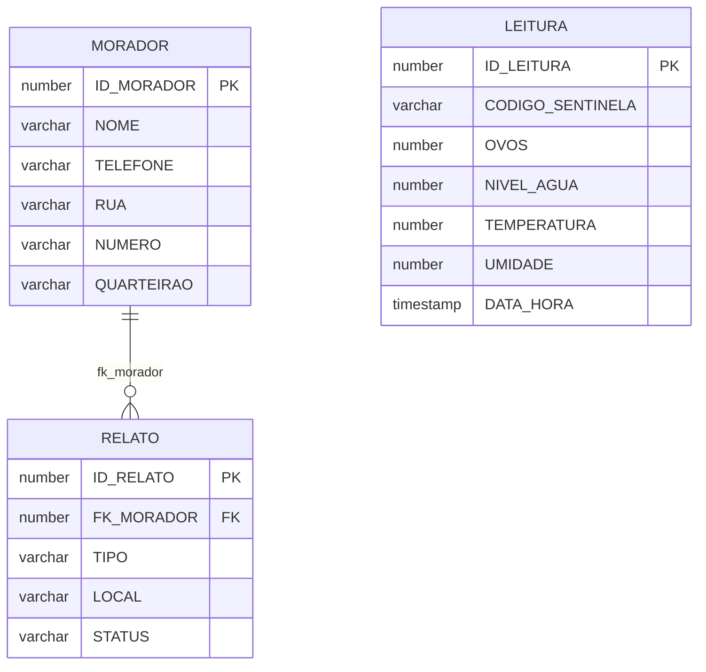
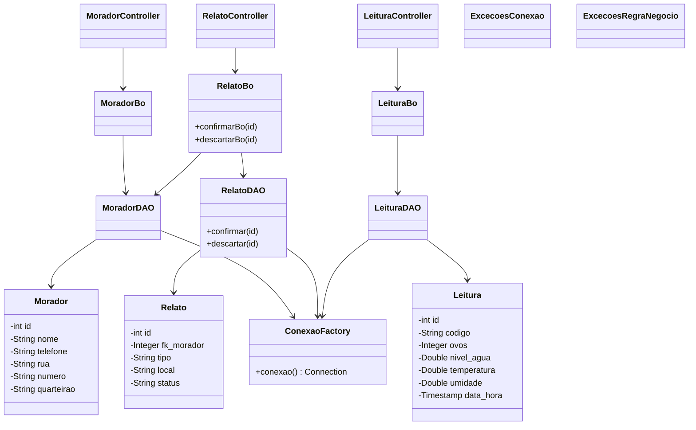

# Documentação do Projeto

**Faculdade:** FIAP  
**Disciplina:** Java  
**Nome da solução:** SentinelaDengue  
**Nome da equipe:** SentinelaDengue

## Integrantes

| Nome | RM |
|---|---|
| João Vitor Piccolo | 565127 |
| Gabrielle Calazans | 564460 |
| Jéssica Domingues | 562973 |
| Kauã Carvalho de Oliveira | 566371 |
| Leonardo Pereira | 561349 |

---

## Sumário

1. [Descritivo da solução](#1-descritivo-da-solução)
2. [Justificativa](#2-justificativa)
3. [Objetivos](#3-objetivos)
4. [Protótipo](#4-protótipo)
5. [Endpoints](#5-endpoints)
6. [Modelo do banco de dados](#6-modelo-do-banco-de-dados)
7. [Diagrama de classes](#7-diagrama-de-classes)
8. [Instruções de execução](#8-instruções-de-execução)

---

## 1. Descritivo da solução

O SentinelaDengue é uma API REST para a vigilância de dengue no bairro. Esta entrega guarda três informações: o morador e o quarteirão dele, o relato de foco que ele envia, e a leitura da sentinela (ovos, água, temperatura e umidade).

O morador é cadastrado com nome, telefone, rua, número e quarteirão. O relato nasce com status `AGUARDANDO` e só muda para `CONFIRMADO` ou `DESCARTADO` por um endpoint próprio. A leitura é recusada quando o código vem vazio, a umidade sai de 0 a 100, a temperatura passa de 60 ou a contagem fica negativa.

O que entra no escopo:

- CRUD de morador, relato e leitura
- Confirmação e descarte do relato
- Regras de campo vazio, morador existente e faixa da leitura
- Persistência no Oracle da FIAP com JDBC

O que fica de fora:

- Tela web pronta (o front consome a API)
- Login com senha / token
- Cálculo de risco, alerta, autovistoria e painel do gestor

---

## 2. Justificativa

A maior parte dos criadouros está dentro das casas, e o morador muitas vezes não está no horário da visita. O relato e a leitura da sentinela são o mínimo para registrar o que acontece no quarteirão e guardar isso no banco, no mesmo formato usado em aula: Model, DAO, BO e Controller.

---

## 3. Objetivos

- Cadastrar o morador ligado a um quarteirão, sem CPF.
- Registrar o relato de foco e permitir confirmar ou descartar só enquanto ele está aguardando.
- Guardar a leitura da sentinela e barrar valor fora da faixa física.
- Expor GET, POST, PUT e DELETE em cada recurso.

---

## 4. Protótipo

A entrega atual é a API. As telas abaixo são os fluxos que o front deve seguir. A base é `http://localhost:8080`.

### 4.1 Morador

```
+----------------------------------+
|            MORADOR               |
|                                  |
|  1. Cadastrar                    |
|  2. Buscar por ID                |
|  3. Listar todos                 |
|  4. Atualizar                    |
|  5. Excluir                      |
+----------------------------------+
```

1. **Listar** — `GET /morador`
2. **Buscar** — `GET /morador/{id}`
3. **Cadastrar** — `POST /morador`

```json
{
  "nome": "Camila",
  "telefone": "11999999999",
  "rua": "Rua das Flores",
  "numero": "120",
  "quarteirao": "Q1"
}
```

4. **Atualizar** — `PUT /morador` com o `id` no JSON
5. **Excluir** — `DELETE /morador/{id}`

Nome, telefone, rua, número ou quarteirão vazio faz a API recusar o cadastro.

### 4.2 Relato

```
+----------------------------------+
|             RELATO               |
|                                  |
|  Morador: 1                      |
|  Tipo: prato de planta           |
|  Local: quintal                  |
|                                  |
|  [ Enviar ]                      |
|                                  |
|  Relato 1 | AGUARDANDO           |
|  [ Confirmar ]  [ Descartar ]    |
+----------------------------------+
```

- Criar: `POST /relato`

```json
{
  "fk_morador": 1,
  "tipo": "prato de planta",
  "local": "quintal"
}
```

A API grava `status` como `AGUARDANDO`. O morador precisa existir.

- Confirmar: `PUT /relato/1/confirmar`
- Descartar: `PUT /relato/1/descartar`

Só um relato `AGUARDANDO` pode ser confirmado ou descartado. O `PUT /relato` altera tipo, local e morador e mantém o status que já estava salvo.

### 4.3 Leitura

```
+----------------------------------+
|            LEITURA               |
|                                  |
|  Codigo: SENT-01                 |
|  Ovos: 12                        |
|  Agua: 3.5                       |
|  Temp: 28                        |
|  Umidade: 70                     |
|                                  |
|  [ Registrar ]                   |
+----------------------------------+
```

```json
{
  "codigo": "SENT-01",
  "ovos": 12,
  "nivel_agua": 3.5,
  "temperatura": 28.0,
  "umidade": 70.0
}
```

A API preenche `data_hora` quando ela não vem no JSON.

### 4.4 Exemplo rápido no terminal

```bash
curl -X POST http://localhost:8080/morador \
  -H "Content-Type: application/json" \
  -d '{"nome":"Camila","telefone":"11999999999","rua":"Rua das Flores","numero":"120","quarteirao":"Q1"}'

curl -X POST http://localhost:8080/relato \
  -H "Content-Type: application/json" \
  -d '{"fk_morador":1,"tipo":"prato de planta","local":"quintal"}'

curl -X PUT http://localhost:8080/relato/1/confirmar

curl -X POST http://localhost:8080/leitura \
  -H "Content-Type: application/json" \
  -d '{"codigo":"SENT-01","ovos":12,"nivel_agua":3.5,"temperatura":28.0,"umidade":70.0}'
```

---

## 5. Endpoints

| Recurso | Método | URL | Função |
| --- | --- | --- | --- |
| Morador | GET | `/morador` | Lista os moradores |
| Morador | GET | `/morador/{id}` | Busca um morador |
| Morador | POST | `/morador` | Cadastra o morador |
| Morador | PUT | `/morador` | Atualiza o morador |
| Morador | DELETE | `/morador/{id}` | Remove o morador |
| Relato | GET | `/relato` | Lista os relatos |
| Relato | GET | `/relato/{id}` | Busca um relato |
| Relato | POST | `/relato` | Cria o relato como `AGUARDANDO` |
| Relato | PUT | `/relato` | Atualiza tipo, local e morador |
| Relato | DELETE | `/relato/{id}` | Remove o relato |
| Relato | PUT | `/relato/{id}/confirmar` | Muda o status para `CONFIRMADO` |
| Relato | PUT | `/relato/{id}/descartar` | Muda o status para `DESCARTADO` |
| Leitura | GET | `/leitura` | Lista as leituras |
| Leitura | GET | `/leitura/{id}` | Busca uma leitura |
| Leitura | POST | `/leitura` | Registra a leitura |
| Leitura | PUT | `/leitura` | Atualiza a leitura |
| Leitura | DELETE | `/leitura/{id}` | Remove a leitura |

POST devolve `201` com o header `Location` e corpo vazio. PUT e DELETE devolvem `200` com corpo vazio. GET devolve o JSON do recurso.

Regras que o BO valida:

- morador: nome, telefone, rua, número e quarteirão não podem ficar vazios
- relato: tipo e local não podem ficar vazios, e o morador precisa existir
- relato novo sempre fica `AGUARDANDO`
- confirmar e descartar só valem nesse status
- leitura: código vazio é recusado; ovos e nível de água não podem ser negativos; umidade fica entre 0 e 100; temperatura acima de 60 é recusada

Quando uma regra falha, o BO lança `ExcecoesRegraNegocio`. O controller declara `throws` e não traduz a exceção. O mesmo vale para `SQLException` e `ClassNotFoundException`.

---

## 6. Modelo do banco de dados

Banco: Oracle FIAP (`oracle.fiap.com.br:1521:orcl`).  
O script `script.sql` cria as três tabelas.



`STATUS` guarda `AGUARDANDO`, `CONFIRMADO` ou `DESCARTADO`. A leitura não tem tabela de sentinela: o código vai na própria linha.

---

## 7. Diagrama de classes

Camadas iguais às usadas em sala: Entity, DAO, Bo (regras) e Controller (REST).



O controller instancia o Bo, o Bo instancia o DAO e o DAO abre a conexão no construtor.  
As regras ficam no Bo. O DAO só roda o SQL.

---

## 8. Instruções de execução

### Ferramentas

- IDE: IntelliJ IDEA
- Build: Maven
- Banco: Oracle da FIAP, script executado no SQL Developer ou cliente equivalente
- Deploy: Render.com, usando o `Dockerfile` do projeto

### Versões

- Java JDK 21
- Spring Boot 4.1.1
- Driver `ojdbc17`
- Oracle em `oracle.fiap.com.br:1521:orcl`

### Links

- Repositório GitHub: (preencher)
- Deploy da aplicação: (preencher)

### Execução

1. Abrir o projeto `GSJava` na IDE.
2. Executar o arquivo `script.sql` uma vez no schema da FIAP. As tabelas são `MORADOR`, `RELATO` e `LEITURA`.
3. Na raiz do projeto, rodar `mvn spring-boot:run`.
4. A API fica em `http://localhost:8080`.

A URL, o usuário e a senha do Oracle estão em `ConexaoFactory`, no mesmo formato da aula. No Render, a única variável usada pelo processo é `PORT`, lida pelo `Dockerfile`. O valor padrão local é `8080`.

Para publicar: criar um Web Service no Render a partir do repositório, com o `Dockerfile` da raiz. O build gera o jar e o container sobe na porta que o Render informar.
